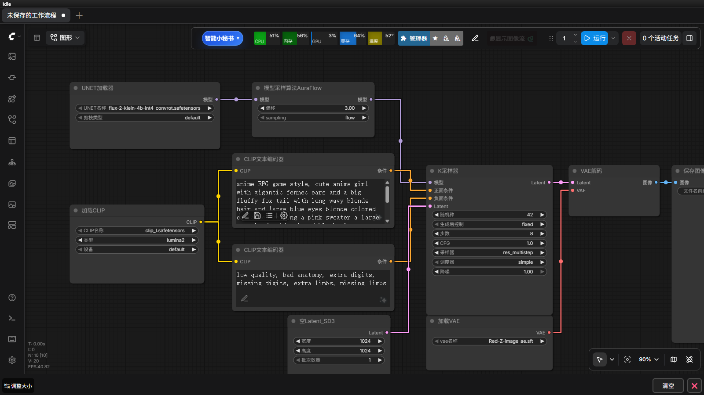
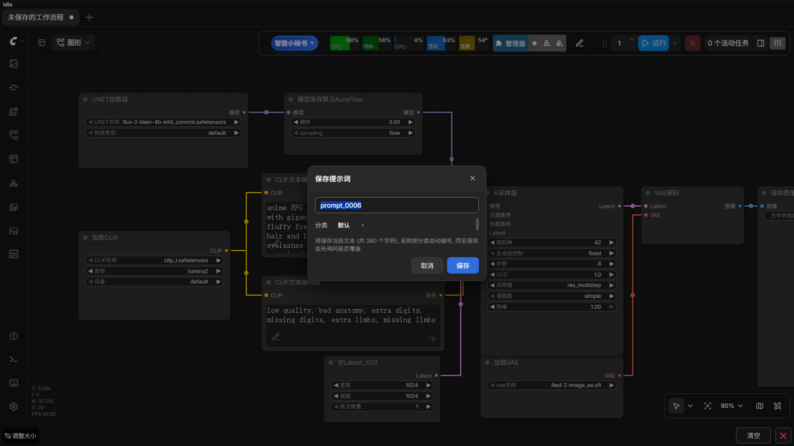
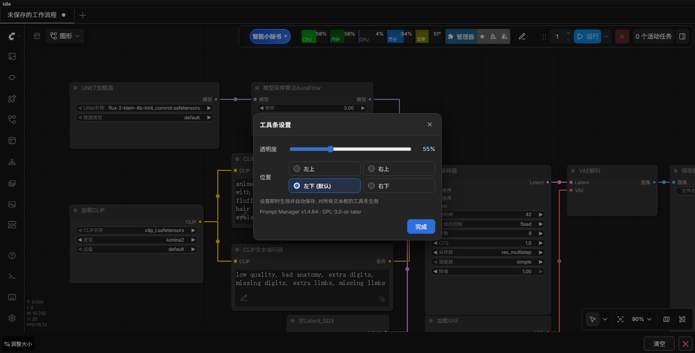

# ComfyUI Prompt Manager (提示词管理器)

<p>  </p>

一个提示词保存插件，**无需添加任何节点**。装好插件后，画布上**所有带多行文本框的节点**（CLIP Text Encode、各种 Positive/Negative 提示词节点等）的文本框内部左下角都会出现一个半透明小图标工具条，可以把提示词保存到 SQLite 数据库、从数据库加载回来。



平时只显示一个 ✏ 小图标，鼠标移上去才展开成 **保存 / 列表 / 设置** 三个按钮，不占地方也不挡文字。

## 安装

方式一（推荐，方便更新）：在 `custom_nodes` 目录下克隆仓库

```bash
cd ComfyUI/custom_nodes
git clone https://github.com/live1617/comfyui-prompt-manager.git
```

方式二：在 GitHub 页面点 **Code → Download ZIP**，解压后把文件夹放到 `custom_nodes` 下。

> ⚠️ 注意不要「套娃」：必须是 `custom_nodes/comfyui-prompt-manager/__init__.py`，
> 而不是 `custom_nodes/comfyui-prompt-manager/comfyui-prompt-manager/__init__.py`。

```
ComfyUI/custom_nodes/comfyui-prompt-manager/
```

无任何第三方依赖（仅使用 Python 内置 sqlite3），无需 pip install。

安装后**重启 ComfyUI** 并**强制刷新页面（Ctrl + Shift + R）**即可——节点列表里**不会**出现新节点（本来就不需要），随便打开一个带多行文本框的节点就能看到工具条。

> 从旧版（带 Prompt Manager 节点）升级：节点已从插件中移除，旧工作流里已添加的
> Prompt Manager 节点会显示为缺失节点，删掉它、改用任意文本节点 + 工具条即可；
> 数据库数据完全通用，无需迁移。

## 使用方式

**顶栏入口**：ComfyUI 顶栏（右上角设置按钮组旁边）有一个 ☰ 列表图标，点开就是提示词列表。
顶栏打开时没有文本框目标，点击条目名称会把内容**复制到剪贴板**（改名 / 移动 / 删除 / 分类管理等操作照常可用）。

平时文本框角落只有一个 ✏️ 笔形小图标，鼠标移上去工具条会展开：

- **🔖 保存**（展开后第一位）—— 弹出「名称 + 分类」输入，把当前文本框内容存入数据库，同名覆盖
  - **名称自动按分类编号**：默认填好 `分类名_0001`、`分类名_0002`…… 「默认」分类用 `prompt_` 开头
    （`prompt_0001`、`prompt_0002`……）；切换分类时自动重算，手输过名称就不再覆盖你的输入
  - 分类是和列表弹窗同一套横向标签页：直接点选已有分类，点「+」可新建
  - 输入已存在的名称时会自动带出它原来的分类；保存时若同名已存在会先弹确认框
- **☰ 列表**（第二位） —— 打开提示词库对话框：搜索 + 分类标签页 + 名称/内容预览，**点击名称即加载到当前文本框**
- **✎ 改名** —— 悬停条目出现（改名绿色），弹出输入框改这条提示词的名字；改成已存在的名字会被拒绝
- **📤 移动** —— 悬停条目出现（移动蓝色，在删除按钮左边），
  点开分类标签选择器（也能「+」新建），点击目标分类即把该条提示词移过去
- **🗑️ 删除** —— 在列表弹窗里操作：悬停条目显示红色删除小图标，或打开对话框的删除模式（有确认）
- ｜
- **⚙ 设置** —— 打开工具条设置面板：
  - **透明度**：滑块调节图标平时的不透明度，拖动即时生效
  - **显示位置**：左下（默认）/ 右下 / 左上 / 右上 四选一，位置在右侧时工具条自动改为向左展开
  - 设置自动保存（浏览器 localStorage），对所有文本框的工具条全局生效

平时图标**不带背景圈**（就是裸的描边小图标），悬停展开时才出现浅色底板承载按钮组。

对话框支持 `Esc` / 点击遮罩关闭。每个文本框独立一套工具条，互不干扰。

**提示词列表**是「左侧分类栏 + 右侧列表」的布局：条目显示名称、内容预览与分类标签，
顶部有搜索框（搜名称或内容），鼠标悬停条目会出现改名（✎）和移动（📤）小按钮。

**保存**时名称按分类自动编号（`分类名_0001`），可顺手选分类，同名会先问是否覆盖：



## 分类

- 保存时选分类（默认 = 「默认」分类），列表按分类管理提示词
- 列表弹窗为「左侧分类栏 + 右侧列表」布局：分类纵向排列（全部 / 各分类，选中有高亮底色），
  点分类只显示该分类内容，条目显示所属分类标签；侧栏底部「+」新建分类、「⚙」分类管理
- 标签条右侧 **⚙ 分类管理**：每个分类可 **✎ 改名**（该分类下所有提示词自动跟随）、
  **↑ ↓ 调整显示顺序**（顺序持久化到数据库，列表分组也按此顺序），改到已存在的名字会合并进那个分类
- 分类管理里还能 **🗑 删除分类**，删除前弹确认并提供两种处理方式：
  ① **删除分类和提示词**（该分类下提示词一起删掉，不可撤销）② **删除分类，提示词保留到「默认」分类**
- 分类存在数据库里，导出/导入的 JSON 会带上 `category` 字段
- 旧版本升级：插件启动时自动给数据表加 `category` 列，已有提示词归到「默认」分类，数据不丢

## 排重复

提示词列表弹窗右上角有个 ⧉ **排重复** 按钮（关闭按钮左边），用来清理内容完全相同的条目：

- 扫描全部提示词，按内容分组（比较时忽略首尾空白），只显示内容重复的组，每组带内容预览
- 每组**默认保留第一条**，点其他条目的「保留此项」可以改选要留下的那条（名称、分类都会显示出来方便判断）
- 底部实时显示「共 N 组重复内容，可删除 M 条」，点红色「删除重复项」后**二次确认**才真正删除
- 没有重复内容时只提示「没有发现内容重复的提示词」，不弹窗

## 导入 / 导出

两个入口都能用：

1. **顶栏列表弹窗 / 快捷浮层里的 ⚙ 按钮** → 弹出「提示词库」对话框，里面是
   *导出提示词库* 与 *导入提示词库* 两张卡片（推荐）
2. ComfyUI 右上角 **设置（齿轮图标）** → 左侧分类 **Prompt Manager** → 同样有这两项

- **导出提示词库 (下载 JSON)**：把数据库全部提示词下载为 `prompt_manager_export.json`（带分类字段）
- **导入提示词库 (选择 JSON 文件)**：默认**纯增加**——库中已有同名且内容相同的跳过、
  内容已存在的也跳过、文件内部自重复只入第一条；同名但内容不同的会提示冲突，改名后可再导入。
  导入完毕后列表会自动刷新

## 数据库

- **数据库文件放在 ComfyUI 的 user 目录下**（SQLite，首次保存时自动创建）
  - 具体位置由 ComfyUI 自己决定（`folder_paths.get_user_directory()`），通常为
    `ComfyUI/user/comfyui-prompt-manager/prompt_manager.db` 或
    `ComfyUI/user/default/comfyui-prompt-manager/prompt_manager.db`；
    **准确路径以启动时控制台打印的那行为准**
  - 刻意放在 user 目录、**不是插件安装目录**——这样无论怎么更新插件
    （哪怕是「删掉整个插件文件夹、解压新版」这种常见做法），积攒的提示词都不会丢
  - **从旧版本升级**：插件首次启动会**自动把插件目录里的旧库复制过去**，控制台会打印迁移后的实际路径；
    旧库**保留不删**（等于天然备份），确认一切正常后可自行删除
  - 想自定义位置：设置环境变量 **`PM_DB_PATH`** 指向目标 `.db` 文件（优先级最高）
  - 取不到 user 目录时（非标准目录结构 / 便携版）自动退回插件目录，插件不会挂
  - 启动时在控制台打印实际使用的路径，形如
    `[PromptManager] 加载成功 v1.4.48 (无需添加节点) | 数据库: D:\...\user\comfyui-prompt-manager\prompt_manager.db`
- 数据表：`prompts(name 唯一, text, category, created_at, updated_at)`
- 同名保存会覆盖旧内容（并更新它所属的分类）

### 自动备份

保存是覆盖式的、导出 JSON 又几乎没人会定期去做，所以插件会在**每次写操作之前**
自动给数据库留一份快照：

- 触发时机：保存 / 覆盖 / 改名 / 移动分类 / 删除 / 批量删除 / 导入 / 分类增删改排序，共 7 类写操作
- 存放位置：与数据库同目录，命名 `prompt_manager.db.20261008-090500.bak`
- **最多保留 10 份**，超出的自动删最旧的；同一秒内连来两次会加 `_2` 序号，不会互相覆盖
- 60 秒内不重复备份，免得连点保存刷出一堆文件
- 用 SQLite 官方 backup API 生成（不是简单复制文件），快照是**事务一致、可直接打开**的完整数据库
- 想关掉：设置环境变量 **`PM_BACKUP=0`** 后重启 ComfyUI
- **误删 / 覆盖错了怎么找回**：挑一份 `.bak` 改名成 `prompt_manager.db` 覆盖回去再重启，
  那一刻之前的内容就回来了

## 局域网访问

用 `--listen` 启动 ComfyUI 时，同一网络里的其他设备也能打开这个页面。插件对此做了区分：

- **其他设备只能看**：浏览提示词列表、搜索、读内容、看 output 里的图都正常；
- **修改只允许运行 ComfyUI 的那台电脑**：保存、改名、删除、移动分类、分类增删改序、去重、导入、
  把图移入回收站，从别的设备调用会返回 `403 local_only`；
- 整包导出、本机目录浏览、带自定义路径的图库读取也只允许本机 —— 它们会暴露这台机器的目录结构。

判定只认来源 IP（回环地址 + 本机网卡地址）。所以在本机用 `localhost` 或局域网 IP 打开都正常，
不会把自己锁在门外。

## 外观微调

- 图标默认透明度：工具条 **⚙ 设置** 面板里可调（保存在浏览器，默认 55%）
- 图标位置：工具条 **⚙ 设置** 面板里可选（左下 / 右下 / 左上 / 右上，默认左下）



## 常见问题

**A. 文本框里没有工具条**

1. 必须**重启 ComfyUI + Ctrl + Shift + R 强刷页面**（工具条是页面加载时注入的）。
2. 确认该节点的文本框是「多行」输入（单行输入框不会注入）。
3. F12 控制台自检：应看到 `[PromptManager] 前端扩展 JS 已加载`；
   刷新后应有若干条 `工具条已挂载 (节点: xxx, 控件: xxx)`。
4. 直接访问 `http://127.0.0.1:8188/extensions` 确认清单里有
   `/extensions/comfyui-prompt-manager/prompt_manager.js`。

**B. 列表对话框里没有内容预览 / 提示「读取列表失败 (404)」**

后端新增的 `/prompt_manager/all` 接口需要**重启 ComfyUI** 才会注册。
未重启时前端会自动降级到旧接口，只能显示名称、没有内容预览。

**C. 设置面板里找不到导入 / 导出**

设置项在页面加载时注册，同样需要 **Ctrl + Shift + R** 强刷一次。

**D. 数据库与日志在哪 / 怎么备份、迁移**

- 实际路径看启动时的控制台日志（`| 数据库: ...`），默认在 ComfyUI 的 user 目录下
  （`ComfyUI/user/` 或 `ComfyUI/user/default/` 里的 `comfyui-prompt-manager/` 子目录）。
- **本机本来就有备份**：数据库同目录下的 `prompt_manager.db.<时间>.bak` 是每次改动前自动留的快照
  （保留最近 10 份）。误删或把提示词覆盖错了，挑一份改名成 `prompt_manager.db` 覆盖回去、
  重启 ComfyUI 即可找回——详细见上面的「自动备份」。
- 数据库用 SQLite 的 **WAL 模式**（读写可以并行：保存提示词时不会卡住列表翻页 / 查重）。
  同目录因此还会出现 `prompt_manager.db-wal` 与 `-shm` 两个附属文件，属正常现象；
  正常关闭 ComfyUI 时会自动合并回主文件。
- 备份 / 换机器：**先正常关闭 ComfyUI，再复制 `prompt_manager.db`**（运行中最近的写入可能还在
  `-wal` 里，只复制主文件会漏掉几步）。更省事的做法是直接**点导出 JSON** —— 那是自洽的可读备份，
  不依赖这些细节。
- 想挪到别的位置：设置环境变量 `PM_DB_PATH` 指向目标文件后重启 ComfyUI。
- **自检**：启动约 8 秒后会对数据库做一次完整性检查（不阻塞启动），通过时控制台打印一行，
  不通过则写进错误日志并提示可从同目录 `.bak` 备份恢复。也可以随时访问
  `GET /prompt_manager/health` 查看库路径 / 大小 / journal 模式 / 备份份数 / 表结构版本 / 完整性结果。
- **错误日志**（`prompt_manager_error.log`）与数据库放在同一个目录，同样不在插件安装目录里
  ——更新插件是「删旧文件夹解压新版」，放安装目录会被一起删掉。日志超过 1 MB 会自动轮转，
  只保留一份 `.1` 备份。想换位置用环境变量 `PM_LOG_PATH`。
  从 v1.4.58 之前的版本升级时，插件目录里的旧日志会自动并入新位置，原件改名成
  `prompt_manager_error.log.migrated`（确认无误后可删）。

## 更多

- **更新日志**：完整的版本历史见 [CHANGELOG.md](CHANGELOG.md)
- **开发文档**：前端模块划分、测试与发版流程见 [DEVELOPMENT.md](DEVELOPMENT.md)

## 致谢

本插件的交互方式（文本框内注入悬停工具条、设置面板等）参考了 [yawiii](https://github.com/yawiii) 的 [ComfyUI-Prompt-Assistant（提示词小助手）](https://github.com/yawiii/ComfyUI-Prompt-Assistant)，特此感谢其优秀的开源作品带来的灵感。

## 开源协议

本项目基于 [GNU General Public License v3.0（GPLv3）](LICENSE) 开源。

你可以自由使用、修改和分发本项目，但若分发（含二次开发的衍生作品），必须：
以 GPLv3 同样授权整个作品、保留版权与许可声明、提供完整源代码、并标明你的修改。
本项目不提供任何担保。完整条款见 [LICENSE](LICENSE)。
